# Highly Available, Auto-Scaled Web Application on AWS

A hands-on AWS project that builds a fault-tolerant, self-healing web tier from the network up: a custom VPC, multi-AZ compute behind an Application Load Balancer, an Auto Scaling Group, and full monitoring with CloudWatch and SNS alerting.

**Stack:** AWS VPC · EC2 · Application Load Balancer · Auto Scaling · CloudWatch · SNS
**Region:** us-east-1 (N. Virginia) · **Instance type:** t3.micro · **AMI:** Amazon Linux

> This is a learning and portfolio build. The environment was intentionally torn down after validation to keep cloud spend at zero (see [Cost management](#cost-management)). All screenshots have had the AWS account ID and public IP addresses redacted.

---

## The scenario

The project is framed around a realistic business problem. "ShopEase", a growing online shopping platform, keeps falling over during sale events: the site crashes under traffic spikes, scaling is manual and slow, and failures are noticed late because there is no monitoring. The goal was to design and build an architecture that removes those failure modes.

**Design goals (what the architecture is built to deliver):**

| Goal | How the architecture addresses it |
|------|-----------------------------------|
| High availability, target 99.9% uptime | Compute spread across 3 Availability Zones behind a load balancer |
| Absorb traffic spikes (up to ~10x) | Auto Scaling Group adds instances automatically as load rises |
| Cost efficiency | Scale back down to a minimum when traffic is low, pay only for what runs |
| Fast failure detection | CloudWatch dashboard plus SNS email alerts |

---

## Why this project matters

Almost every internet-facing application eventually hits the same wall: a single server cannot stay up and keep up at the same time. The moment traffic is unpredictable, one machine is both an availability risk (if it dies, the site is down) and a performance risk (if it is overwhelmed, the site is slow). This project builds the standard AWS answer to that problem, a pattern you can drop under almost any web workload to make it survive failure, scale with demand, and report when something is wrong, all without someone watching it by hand.

### Use cases

This architecture fits any public web application where uptime and variable traffic both matter:

- **E-commerce and retail:** survive flash sales, Black Friday, and product launches where traffic can jump 10x in minutes.
- **Ticketing and event booking:** absorb sudden demand bursts the instant tickets go on sale, without the site collapsing.
- **Media, news, and content sites:** stay responsive when an article or video goes viral and traffic spikes unpredictably.
- **SaaS and web apps with uptime commitments:** meet availability targets (for example 99.9%) backed by multi-AZ redundancy.
- **Campaign and landing pages:** handle a marketing push or a post that takes off, then scale back down so you are not paying for idle servers.
- **Public APIs and backends:** keep a service layer available and auto-scaling as client demand rises and falls.

### What it demonstrates

Beyond the specific scenario, the build shows the three properties any production web tier is expected to have:

- **High availability:** no single point of failure; the workload spans multiple Availability Zones behind a load balancer.
- **Elasticity:** capacity follows demand automatically, so the system handles spikes and trims cost when quiet.
- **Self-healing and observability:** failed instances are replaced automatically, and health and alerts are wired in from day one.

---

## Architecture

The AWS Cloud hosts an Elastic Load Balancer that spreads traffic across EC2 Auto Scaling groups running in multiple Availability Zones. This is the design the project was built to:

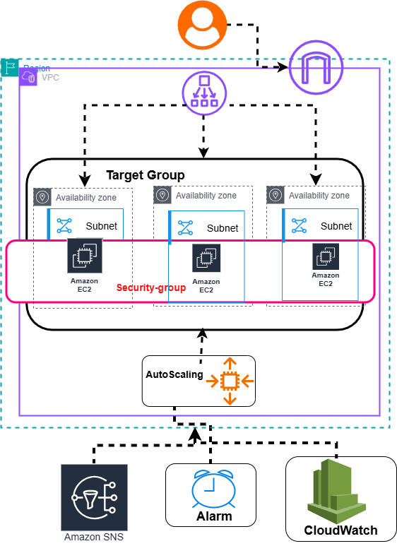

**Request path:** a user request hits the Internet Gateway, reaches the internet-facing Application Load Balancer, and is distributed across healthy EC2 instances in multiple Availability Zones. The Auto Scaling Group keeps the fleet at the right size, and CloudWatch watches health and performance, raising alerts through SNS.

<details>
<summary><b>Detailed view: resources and data flow (click to expand)</b></summary>

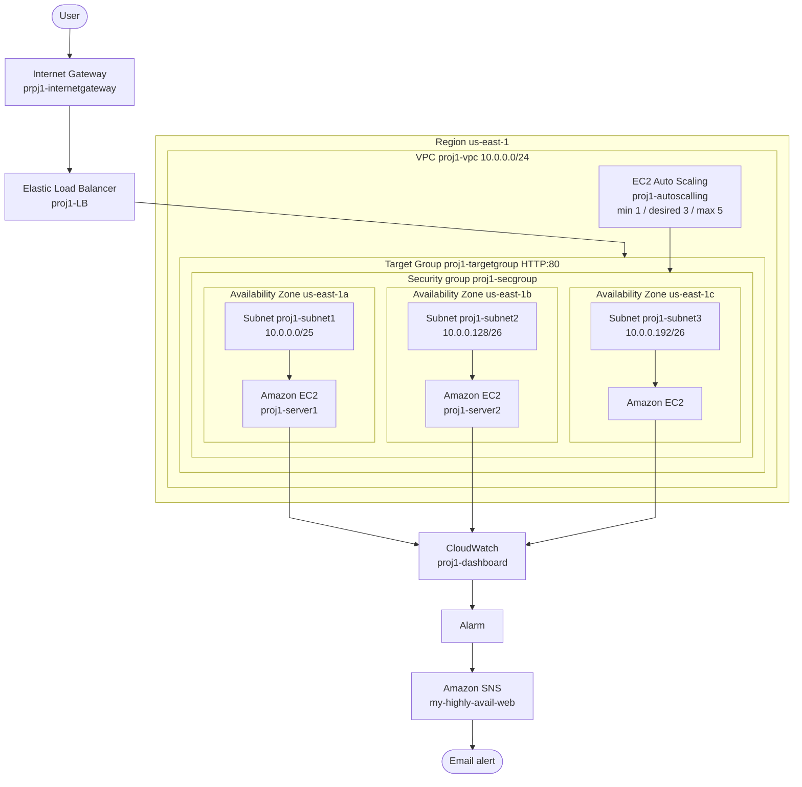

</details>

---

## Build walkthrough

Each step below is backed by a screenshot from the live console. Resource IDs are left visible; only the account ID and public IPs are redacted.

### 1. Networking foundation (VPC)

A custom VPC (`proj1-vpc`) with a `10.0.0.0/24` address range provides an isolated network for the application.

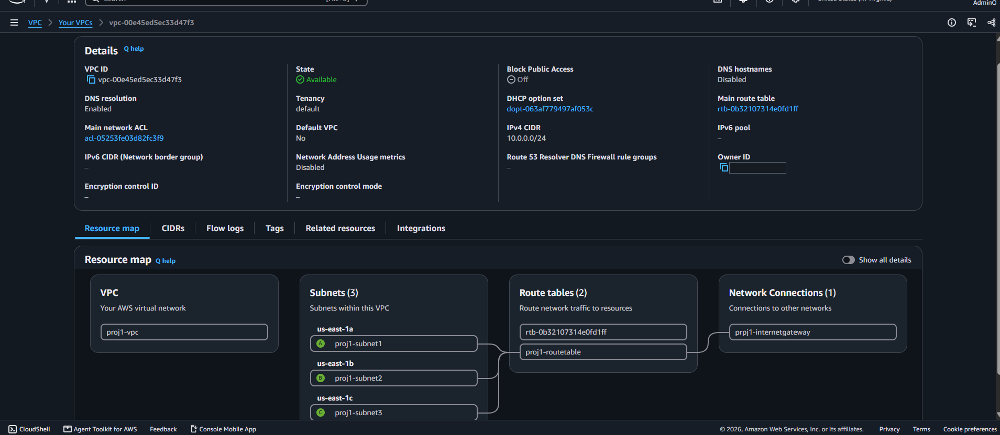

### 2. Subnets across three Availability Zones

Three subnets are carved out of the VPC, one per Availability Zone, so the workload can survive the loss of an entire AZ.

| Subnet | CIDR | Availability Zone |
|--------|------|-------------------|
| proj1-subnet1 | 10.0.0.0/25 | us-east-1a |
| proj1-subnet2 | 10.0.0.128/26 | us-east-1b |
| proj1-subnet3 | 10.0.0.192/26 | us-east-1c |

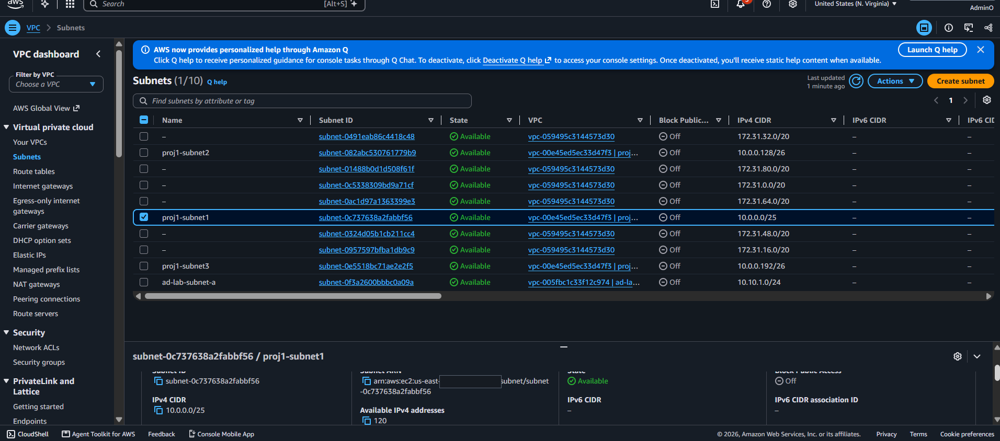

### 3. Route table

A route table (`proj1-routetable`) is associated with all three subnets and sends outbound traffic to the Internet Gateway, making them public-facing.

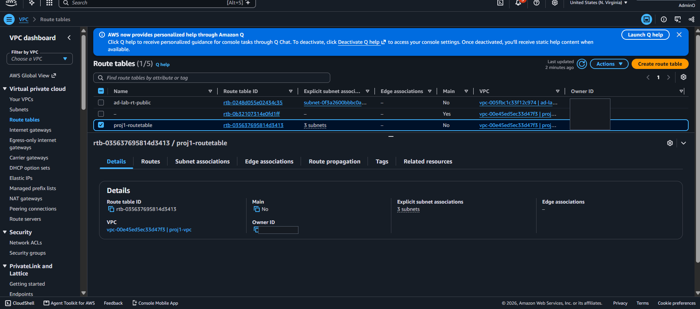

### 4. Internet Gateway

The Internet Gateway (`prpj1-internetgateway`) is attached to the VPC, giving the public subnets a path to and from the internet.

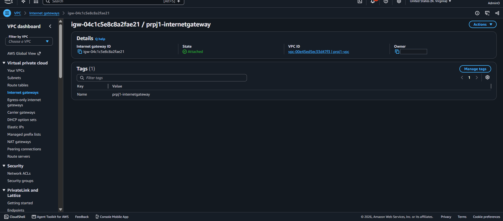

### 5. EC2 instances

Baseline web servers (`proj1-server1` in us-east-1a, `proj1-server2` in us-east-1b) run as `t3.micro` instances. Spreading them across AZs means a zone failure does not take the whole application down.

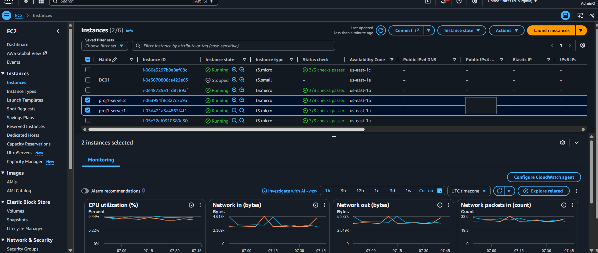

### 6. Security group

The security group (`proj1-secgroup`) controls inbound access:

| Type | Protocol | Port | Source |
|------|----------|------|--------|
| HTTP | TCP | 80 | 0.0.0.0/0 |
| HTTPS | TCP | 443 | 0.0.0.0/0 |
| SSH | TCP | 22 | 0.0.0.0/0 |
| ICMP | ICMP | All | 0.0.0.0/0 |

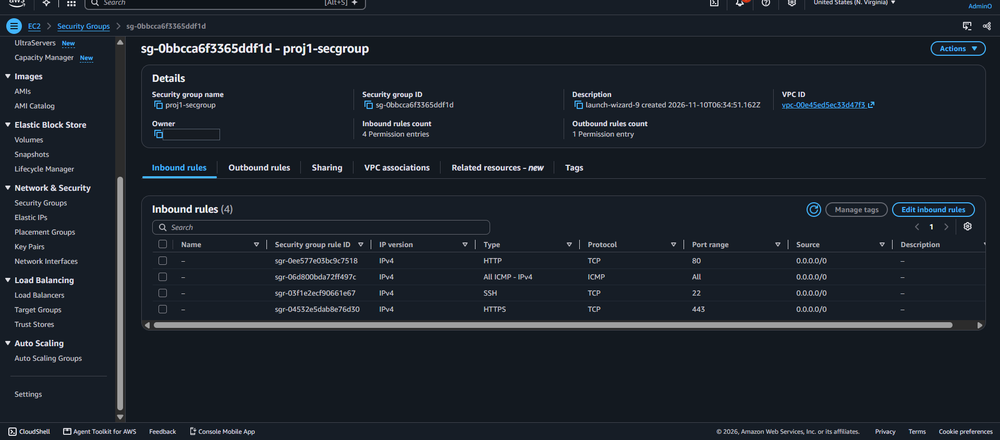

> See [Security considerations](#security-considerations) for how these rules would be tightened for production.

### 7. Application Load Balancer

An internet-facing Application Load Balancer (`proj1-LB`) spans all three Availability Zones and listens on HTTP:80, forwarding traffic to the target group. It gives the application a single stable entry point and health-aware traffic distribution.

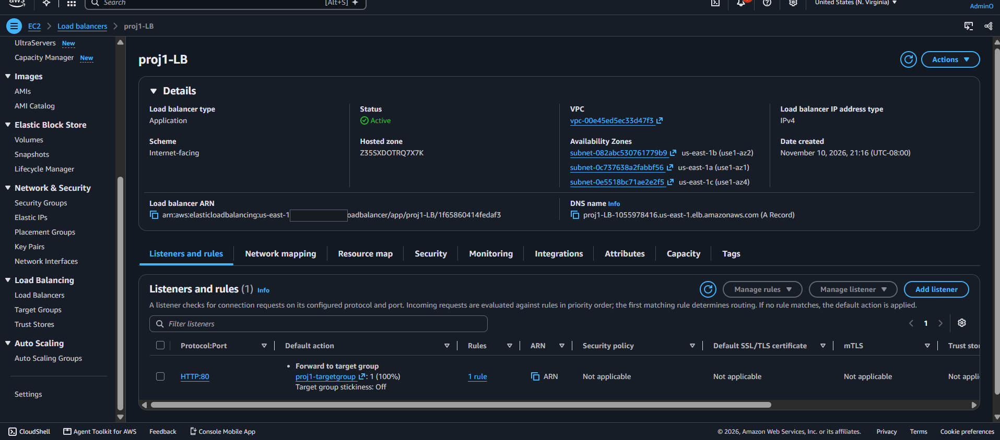

### 8. Target group

The target group (`proj1-targetgroup`) registers the EC2 instances on HTTP:80 and runs health checks, so the load balancer only sends traffic to instances that are actually serving the app.

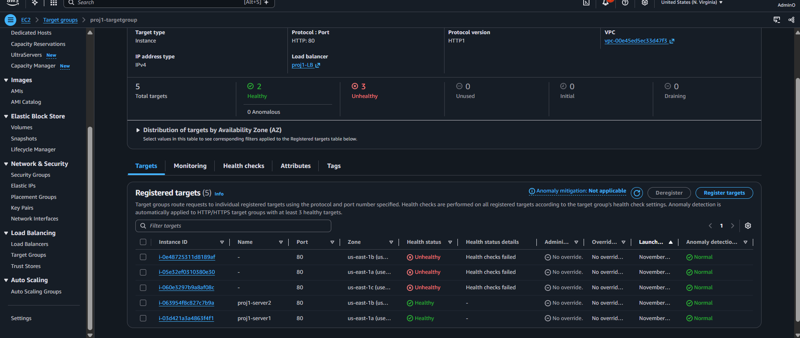

### 9. Auto Scaling Group

The Auto Scaling Group (`proj1-autoscalling`) uses a launch template (`myproj1-template`) and is configured with a minimum of 1, a desired capacity of 3, and a maximum of 5 instances, balanced across the three AZs. The group scales between its minimum and maximum as demand changes, which is what delivers both elasticity and self-healing.

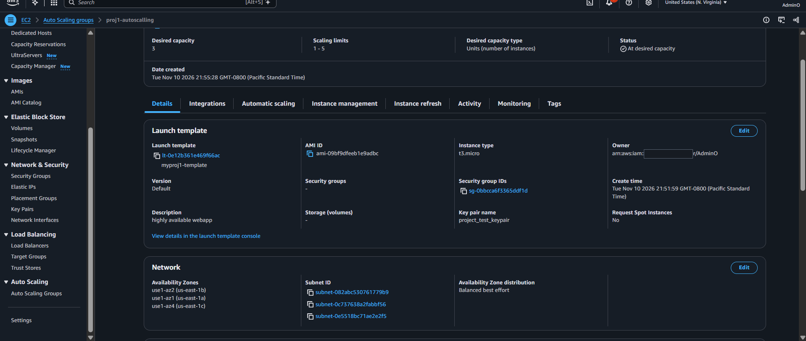

### 10. CloudWatch dashboard

A CloudWatch dashboard (`proj1-dashboard`) brings the key signals together: CPU utilization, network in and out, status checks, request count per target by AZ, and SNS delivery metrics.

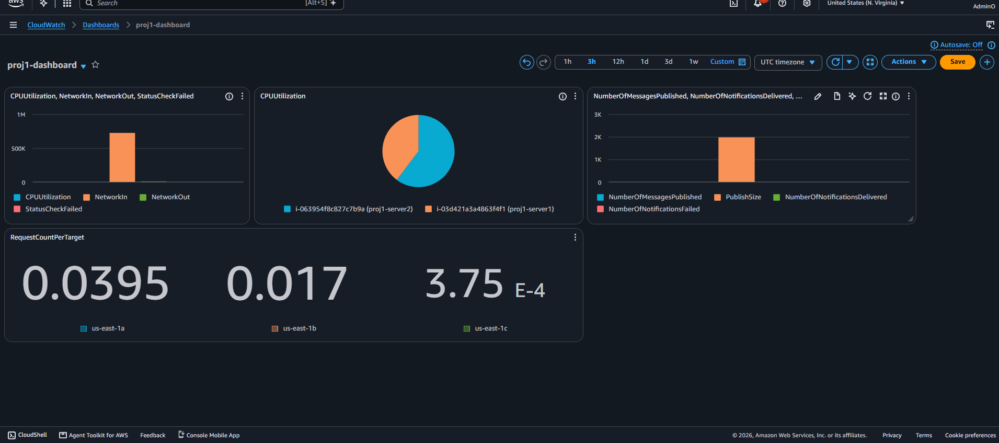

### 11 & 12. SNS alerting

An SNS topic (`my-highly-avail-web`) with a confirmed email subscription delivers notifications when CloudWatch alarms fire, so issues are surfaced immediately rather than discovered after the fact.

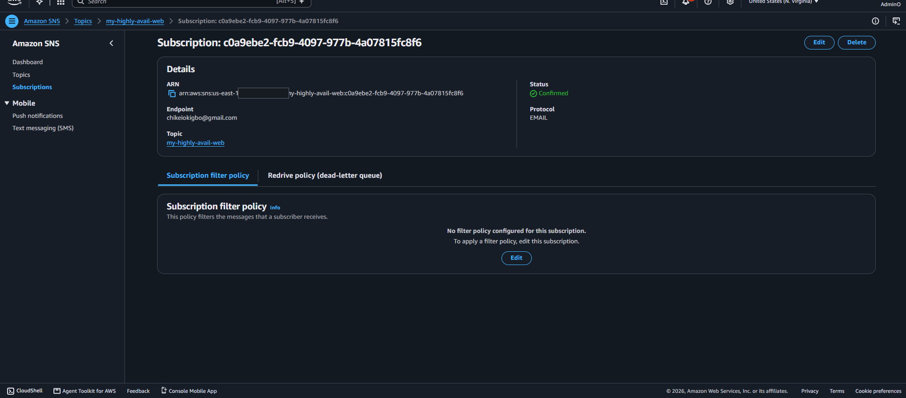
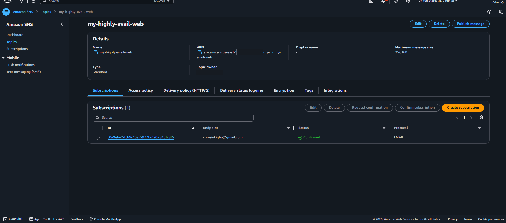

---

## Validation and testing

The self-healing behaviour was tested directly, not just assumed:

- **Auto-recovery test:** an EC2 instance was terminated manually to simulate a failure. The Auto Scaling Group detected the drop below desired capacity and automatically launched a replacement, bringing the fleet back up to its target size. This confirms the group keeps the application at full strength without any manual intervention.
- **Elasticity:** the group is configured to scale out to as many as 5 instances under load and back down to a minimum of 1 when idle, which is the mechanism that absorbs traffic spikes while controlling cost.
- **Monitoring path:** CloudWatch metrics populate the dashboard and the SNS email subscription is confirmed, so the alarm to notification path is live end to end.

**Result:** the architecture met its core goals. Multi-AZ placement plus the load balancer deliver high availability, and the Auto Scaling Group was observed restoring capacity automatically after an instance was removed, demonstrating the self-healing that the 99.9% uptime goal depends on.

---

## Security considerations

For a learning build the security group is deliberately permissive. In a production deployment I would:

- Restrict SSH (port 22) to a known bastion host or a specific admin IP range instead of `0.0.0.0/0`.
- Place the EC2 instances in private subnets and expose only the load balancer publicly.
- Add HTTPS termination with an ACM certificate on the load balancer and redirect HTTP to HTTPS.
- Remove the broad ICMP rule once network troubleshooting is complete.

Calling these out is part of the exercise: the build works, and the next iteration hardens it.

## Cost management

To avoid ongoing charges, the entire environment was torn down after the architecture was built and validated. Running cost is therefore zero. The screenshots in this repository are the record of the working deployment. Everything here can be rebuilt from the same steps.

## Skills demonstrated

- Designing a multi-AZ, highly available architecture on AWS
- VPC networking: subnets, route tables, internet gateways, CIDR planning
- Load balancing and health checks with an Application Load Balancer and target groups
- Elastic, self-healing compute with Auto Scaling Groups and launch templates
- Observability and alerting with CloudWatch dashboards and SNS
- Cost-aware cloud practice (build, validate, tear down)

## Repository structure

```
aws-ha-webapp/
├── README.md
├── assets/
│   └── architecture-diagram.png
└── screenshots/
    ├── 01-vpc.png
    ├── 02-subnets.png
    ├── 03-route-tables.png
    ├── 04-internet-gateway.png
    ├── 05-ec2-instances.png
    ├── 06-security-group.png
    ├── 07-load-balancer.png
    ├── 08-target-group.png
    ├── 09-auto-scaling-group.png
    ├── 10-cloudwatch-dashboard.png
    ├── 11-sns-subscription.png
    └── 12-sns-topic.png
```
